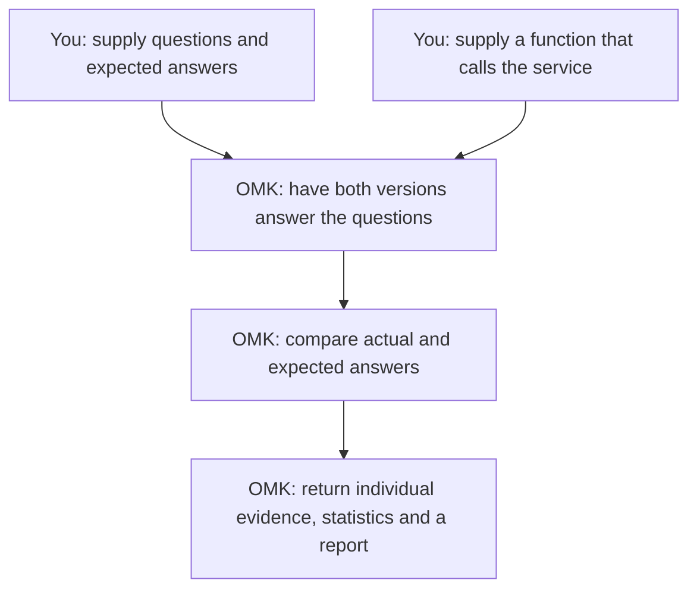

# Compare two versions in code

**eval-runtime is OMK's evaluation interface for Node.js programs.** Call `evaluate()` to run versions on your test cases, score their answers, and get a comparison result. You supply the code that calls your answering service, RAG system, or Agent.

This guide does one thing: compare an old and a new answering service. First see what happens in one evaluation, then run that same example.

## What happens in one evaluation

Suppose the service should return only a city name. Prepare three questions and write down the correct answers before running the service:

| Question | Expected answer | Old answer | New answer |
|---|---|---|---|
| What is the capital of France? | 巴黎 (Paris) | 巴黎 ✓ | 巴黎 ✓ |
| What is the capital of the UK? | 伦敦 (London) | 伦敦 ✓ | 伦敦 ✓ |
| What is the capital of Japan? | 东京 (Tokyo) | 京都 (Kyoto) ✗ | 东京 ✓ |

The runnable example uses Chinese questions and city names. You supply the first two columns; the service produces the last two. **Expected answers go only to the scorer, never to the service under test.**

The scoring rule here is simple: an answer is correct if it exactly matches the expected answer. OMK gets **2/3** correct for the old version and **3/3** for the new one, a gain of about **33.3 percentage points**. It then checks whether the evidence supports that difference. Three questions do not establish that the new version is reliably better.



Two names now have a concrete meaning:

| Name in code | Job in this example |
|---|---|
| `executor` | Call the answering service and get an actual answer such as “巴黎”. |
| `evaluator` | Check whether the actual answer matches the expected answer. |

## Run this example

<a id="where-to-start"></a>

Use Node.js 22 or newer. From the OMK source repository root, run:

```bash
yarn install --immutable
yarn build
node examples/eval-runtime/run.mjs
```

**The example simulates the table above with fixed answers. It calls no model and needs no model account.** It teaches the evaluation process; measuring a real service requires connecting and evaluating that service.

The command prints one JSON line. Start with these three fields:

| Field and value | Meaning |
|---|---|
| `runStatus: "completed"` | This run finished. |
| `estimate: 0.3333333333333333` | New accuracy minus old accuracy: about 33.3 percentage points. |
| `verdict: "NOISE"` | This difference does not establish improvement; it does not establish equivalence either. |

`runStatus` is the example's output label for `result.status`. The output also contains a report ID. The caller saves the report data; Runtime does not automatically open Studio.

<details>
<summary>Expand the complete runnable code</summary>

This is the [run.mjs](https://github.com/lizhiyao/oh-my-knowledge/blob/main/examples/eval-runtime/run.mjs) you just ran. You do not need to assemble it from the explanation fragments below.

<<< @/../examples/eval-runtime/run.mjs{js}

</details>

## Find the corresponding parts in the code

Open `examples/eval-runtime/run.mjs` and find these three places. The following fragments help you read the complete file.

**① Questions and expected answers: `dataset.samples`.** Each record is one question.

```js
{
  sampleId: 'three',
  input: { prompt: '日本的首都是哪里？' },
  expected: '东京',
}
```

**② Versions under test: `variants`.** This example has `baseline` (old) and `candidate` (new). Both use the same `executor`; `config.deployment` selects the version. The demonstration function simply looks up a fixed answer:

```js
output: answers[config.deployment][input.prompt]
```

OMK passes each question to each version. Three questions therefore call this function six times.

**③ Scoring and summaries: configuration passed to `evaluate()`.** Each part has one job:

| Configuration | Meaning in this example |
|---|---|
| `evaluators` | Use `exact-match` to check whether answers match exactly. |
| `comparisons` | Treat `baseline` as the control and compare `candidate` accuracy with it. |
| `analyses` | Compute the difference in accuracy and its confidence interval. |
| `decision` | Use that analysis to give a verdict such as `NOISE`; this part is optional. |

Try a small change: in `answers.candidate`, change Japan's answer from `东京` to `京都`, then run again. Both versions now answer only two questions correctly, so `estimate` should become **0**. This shows that scores come from the answers actually returned.

## What to change for your own service

Keep using this file. Replace the questions and expected answers, then replace the lookup in `executor.execute()` with a real service call. Return `{ output, usage }`: `output` is the actual answer and `usage` is real usage. Do not keep the example's simulated token counts.

To compare two **prompts**, make your invocation code use `artifact.content` as the actual prompt. Hold the model, tools, and other conditions fixed while changing the two prompt versions. The example lookup ignores prompt content, so editing its `artifact.content` will not change its scores.

Three other parts must match your real service:

- **Data formats:** Declare input, configuration, and output formats in the executor's `schemas`; update those declarations when changing the data.
- **Runtime capabilities:** A stochastic model must not copy `deterministic`. Without model seed control, declare `stochastic` and `seedControl: 'unsupported'`, and set `experiment.sampling` to `{ samplingKind: 'paired', seedCoupling: 'uncontrolled' }`. If you declare cancellation support, forward `signal` to the real call.
- **Credentials and failures:** Keep clients and secrets in the invocation closure, outside recorded `config` and `runtimeContext`. Throw or return a stable `errorCode` on failure rather than inventing an answer to score.

Expand [“Exact match and model integration code”](../../reference/integration/eval-runtime-recipes.md#exact-match-evaluation) below for the complete model integration pattern. It uses your own model client. Set [concurrency, timeouts, and budgets](../../reference/integration/eval-runtime-recipes.md#production-policy) for your service before deployment. In an independent project, install `npm install oh-my-knowledge@next zod` and use examples matching the installed version; run unreleased capabilities from source first.

<a id="read-results"></a>
<a id="read-the-results"></a>

After connecting a real service, check `result.status` and valid sample coverage before interpreting differences and intervals. Failed calls and missing evidence are not zero scores. Use representative questions and a separate validation set to judge whether a change helps.


## Continue as needed

- [Configuration and runnable recipes](../../reference/integration/eval-runtime-recipes.md): Scoring methods, model integration, persistence, production policy, and Agent resources; look up only what you need.
- [Runtime API](../../reference/integration/eval-runtime-api.md): Fields and dispatch contracts.
- [Platform integration](platform-host-integration.md): Host wiring for existing scheduling and storage systems.
