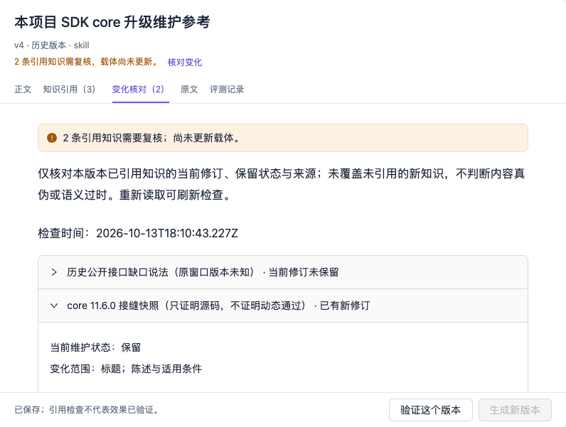

# SDK case: review artifacts when their knowledge changes

This frozen case demonstrates maintenance behavior accepted on 2026-10-14: associate later sources, limit old statements to their historical context, revise or discard knowledge, then review and update an artifact. It uses the existing sentry-miniapp SDK materials. The OMK implementation at that time read an independent copy, and Studio opened v4 and v5 for review.

The screenshots and v4/v5 identities belong to that earlier knowledge contract. The current canonical-body reader does not read an old workspace in place. Follow the [knowledge maintenance workflow](extract-knowledge.md) to migrate explicitly into a new directory, review the new pending bodies, and make new retain decisions. Old artifact and library references are archived rather than automatically redirected. Those identities and screenshots alone do not verify the current body workflow; a package version number alone does not establish data compatibility. The next section records a separate readback under the current contract.

For first use, create your own workspace with the [knowledge maintenance workflow](extract-knowledge.md). This page explains concrete results; it requires neither installing the SDK nor calling a model.

## Closure under the current canonical-body contract (2026-10-29)

[#1174](https://github.com/lizhiyao/oh-my-knowledge/issues/1174) ran the production knowledge application, storage adapters, and Codex generation flow in a new local workspace. Inputs were two faithfully recovered selected and deidentified historical windows, a manual static observation, and an actual test-tool record from this run. Complete original conversations were not recovered, and lost historical artifact-task identities were not resumed. Three generation sources produced six complete bodies, with one body and one association model invocation per source. Source review preserved historical reports, unknown versions, and static-evidence limits.

An Agent explicitly retained five items for the first artifact v1; the #428 business-acceptance item remains pending. A later revision added actual test results from the fixed SDK snapshot: 52 passing tests across four existing files, limited to Node and an in-memory transport. The new revision first returned to pending while the old retain decision remained bound to its old revision; the Agent then explicitly retained the new revision. Agent maintenance is not human Gold; the artifact verification status remains `not_assessed`.

| Readback | Actual result |
|---|---|
| New artifact v2 | Three kept, one replaced, one removed; the removed historical repair report remains retained in the knowledge store. |
| Precise references | v1 keeps the old revision and reports one change; v2 references the selected current revisions and reports zero changes. |
| Content and assets | Every v1 file remains byte-identical; manual content, custom metadata values, and four distributable assets are preserved. |

The [current-contract readback record](../../public/sdk-body-closure-evidence.json) provides both artifact identities, body digests, exact knowledge references, and a separate task comparison. Complete knowledge text, raw returns, and execution diagnostics remain local. The two primary Markdown files contain 43,077 and 39,659 bytes; they were not clipped to 8KB.

The task comparison preserves the two SDK review questions, their original Boolean/path verifier, and seven fixed source files, with one run per question and version. It measures consumption of the provided primary Markdown. Asset preservation was checked separately; native Skill discovery and asset reading are outside this comparison. v2 both adds runtime evidence and removes a superseded report, so results cannot be attributed to one knowledge item. The readback record owns actual outcomes and costs. A small set of previously exposed questions cannot establish general knowledge benefits; [#1115](https://github.com/lizhiyao/oh-my-knowledge/issues/1115) continues that research independently.

All four model executions and four local acceptance checks succeeded without retries. Both v1 and v2 passed both questions; no acceptance-rate gain was observed. The batch took about 9 minutes 12 seconds, reporting 904,770 input tokens (including 771,712 cached) and 2,538 output tokens. These are cumulative Agent-interaction totals, not a single prompt length. USD cost was unreported and remains unknown. The separate six body/association generation invocations took about six minutes, reporting 123,821 input and 24,485 output tokens. Maintenance and artifact saving made no additional model calls.

## Historical materials and scope (2026-10-14)

- The object is this project’s `@sentry/core` component. A version is an observation condition and does not automatically become a separate component identity.
- Historical windows discuss protected overrides and Session isolation. Old statements remain historical records and cannot establish unresolved problems today.
- Later observations froze [SDK source 30ffb003](https://github.com/lizhiyao/sentry-miniapp/commit/30ffb0030376e63a943f5d69beced539c7810171), recording the `@sentry/core 11.6.0` dependency, source seams, and test source. These are manually curated static materials; no dynamic SDK tests ran.
- See [#1166](https://github.com/lizhiyao/oh-my-knowledge/issues/1166) for maintenance acceptance and [#1168](https://github.com/lizhiyao/oh-my-knowledge/issues/1168) for change notices and update review. Reading the independent copy preserved the original 27 files and made no new model calls.

## From sources to a new artifact

| Stage | Actual change in this case | What to review |
|---|---|---|
| Accumulation | After explicit human confirmation, the core object’s source-window members grew from two to three. | Sources and object meaning; matching names do not merge automatically. |
| Historical revision | Old correction requirements gained historical conditions; new revisions received new retain decisions. | Original text, conditions, unknowns, and reasons. |
| Stop carrying a statement | The historical public-interface-gap statement, with an unknown source version, was discarded. | Keep its history while excluding it from the currently used artifact. |
| Clarify a condition | Static knowledge explicitly states that it proves source presence, not dynamic test success. | Saving test source is different from running it successfully. |
| Change notice | Historical v4 still references three items; two require review. | Current revisions and retain decisions; notices do not determine truth or semantic expiry. |
| Explicit update | v5 selects two currently retained items: keep one, replace one, remove one. | Reference changes, content, exact revisions, and dependency assets. |
| Historical reading | v4 content and three references remain readable; v5 detects zero reference changes. | No reference changes does not establish correctness or effectiveness. |

## Check the exact references

The [frozen readback record](../../public/sdk-maintenance-evidence.json) records the observation time, OMK runtime commit, artifact identity, and full revision identities for v4 and v5. It also records source availability and the object's historical member counts (2 → 1 → 2 → 3); the temporary removal and re-association are retained, followed by a third source window.

| Knowledge | Historical v4 | Current v5 |
|---|---|---|
| Historical protected-override and Session review | Revision `1009571e` retained | Same exact revision kept |
| Historical public-interface-gap statement | Revision `6bce64dd` referenced | Explicitly removed after discard |
| core 11.6.0 static seam snapshot | Revision `7113ba63` referenced | Replaced with `6f23942d`, limiting the claim to source presence |

These are frozen case facts, not live SDK status. The record omits local workspace paths and raw conversations; linked acceptance issues own provenance and limitations. Use full identities from the JSON when checking the underlying material, rather than matching titles alone.

## Historical Studio review

The following steps record the 2026-10-14 acceptance under the earlier contract. They do not replay those identities in a newly migrated workspace; review new bodies and create new artifacts explicitly there.

1. Open the knowledge library, inspect an object’s source members, then follow an item back to its original text. Review candidate conditions and evidence before retaining or discarding it with a reason.
2. Open the saved artifact, choose historical v4, and open “Review changes”. Its two notices come from a knowledge revision and an item that is no longer retained.
3. Expand a change, compare “Incorporated revision” with “Current knowledge revision”, and inspect titles, statements, and conditions. Follow references to the corresponding knowledge detail.
4. Return to the current version, choose “Generate new version”, review the kept, replaced, and removed references, then save explicitly. Only the selected knowledge region is rebuilt; manual content and dependency assets remain.
5. Reload the latest artifact and inspect content and “Knowledge references”. Switch back to the historical version to verify readability. Enter evaluation from an explicit version only when task-effect evidence is needed.

The screenshot records the real reader used for that Chinese case, comparing its historical references with the then-current knowledge. It is neither a new model extraction result nor acceptance of the current canonical-body contract. Its versions and timestamps belong to the frozen case.

When sources are missing, reads fail, or a file changes externally, inspect the notice and reload. A failure is not evidence of no changes. Checks cover knowledge referenced by this version and exclude unreferenced new items. See the [maintenance contracts](../../specs/knowledge/knowledge-maintenance.md) for complete behavior boundaries.

## What the historical evidence supports

A traceable maintenance and revision path: v4 keeps its three historical references; v5 references only the two selected current revisions, with content matching the saved manifest.

It does not establish correct dynamic SDK behavior after an upgrade, time saved, automatic cross-agent reuse, or each item’s independent contribution. It uses previously exposed materials and author review; a recorded manual-curation adapter is not automatic extraction success. [Knowledge-benefit research](https://github.com/lizhiyao/oh-my-knowledge/issues/1115) continues to track actual use and benefits separately.
