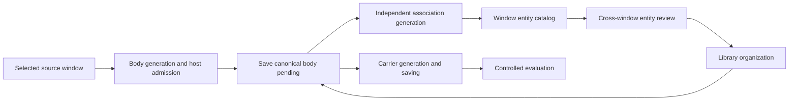

# Knowledge construction and maintenance contracts

This document is the end-to-end design for turning selected records into maintained knowledge and measurable carrier changes. It owns the connections between stages, identity boundaries, and architectural decisions. [Knowledge principles](../../explanation/knowledge.md) alone own concept definitions; the [knowledge maintenance guide](../../guides/knowledge/extract-knowledge.md) owns user steps. Detailed contracts remain in the linked stage specifications rather than being copied here.

## 1. Delivered scope {#current-scope}

Within an explicitly chosen local workspace, CLI and Studio share source capture, candidate extraction, review decisions, immutable revisions, entity correction, tags, cross-window entity review, entity-library organization, and carrier saving. Human-confirmed cross-window organization is implemented. Automatic cross-Agent identity unification is outside this design; neither a model suggestion nor a library link establishes truth or reuse benefits.

The design does not require a graph database, embedding retrieval, background identity merging, or automatic deletion of contradicted claims. Each would need its own explicit contract and evidence before adoption.

## 2. Objects and responsibilities {#current-objects}

| Object / record | Owner and responsibility |
|---|---|
| Source window | Selected excerpts, source identity, scope, and limits; later judgments can return to the same evidence |
| Source entity analysis | Window-local objects, mentions, and immutable analysis revisions; no cross-window unified identity |
| Entity-link review | Pinned entities from two windows, exact model request/outcome, structural admission, separate human decision, and recoverable library intent |
| Canonical knowledge body | Stable knowledge/revision/segment identities, complete natural-language segments and inline exact source evidence; new revisions are pending |
| Derived association | Independent entity/optional typed projection of an exact body digest; separate revisions and accept/reject review, never a second canonical body |
| Maintenance decision | Retain/discard and reason for an exact knowledge revision; retention is not truth verification |
| Library object | User-confirmed cross-window organization; references source identity without copying content |
| Tags | User-maintained topic organization with separate history; does not revise content |
| Knowledge carrier | Selected knowledge revisions organized as skill/prompt versions, saved separately from content |
| Measurement evidence | Existing Core run/report/Decision testing a specific carrier change; not a substitute for review |

One carrier may cite many items; one item may appear in multiple carriers or object entries. Each retains its identity. Names, chronology, or UI placement establish neither identical objects nor claim truth.

### 2.1 Stages and contract ownership {#construction-pipeline}

The order is intentional: the complete body is admitted and saved before an independent association call. An absent or failed projection cannot block body reading or maintenance. The library adds cross-window organization, not another canonical content store.

| Stage | Responsibility and hand-off | Authoritative specification |
|---|---|---|
| Window extraction | Freeze source and each phase request; archive each complete returned outcome before decoding; persist admitted body pending before association generation. | [Entity extraction](../entities/entity-extraction.md) |
| Host admission | Resolve exact quote occurrences to UTF-16 positions; validate wire/domain structure and reference closure; retain admitted body siblings and the original outcome; derived validation never deletes saved body. Admission does not adjudicate semantics. | [Extraction contracts](../entities/entity-extraction.md#_3-contracts-and-identity) and [identity rules](../entities/entity-identity.md) |
| Entity catalog | Query current window analyses while preserving analysis/entity/revision identities; disclose unreadable analyses and sources. Search does not create a shared identity. | [Extraction storage and catalog](../entities/entity-extraction.md#_6-current-storage-contracts) |
| Cross-window review | Normalized recall → bounded preview → confirmed durable preparation → governed model suggestion → archived outcome and admission → explicit human acceptance/rejection → recoverable application. Retrieval and model advice cannot publish organization. | [Entity-link journal](../entities/entity-links.md); [Studio transport](../studio/studio-entity-links.md) |
| Library organization | Reference original window identities through a separately maintained object; confirm identity and source evidence; publish immutable membership revisions under the workspace lock. | [Entity knowledge library](knowledge-library.md) |
| Knowledge maintenance | Retain/discard an exact knowledge revision, revise complete body drafts and exact inline evidence; apply/review entity associations independently. Organization never transfers a claim automatically. | [Sections 3–4](#current-revisions) and [maintenance contract](knowledge-maintenance.md) |
| Carrier generation and saving | Select exact retained revisions, preserve conditions and evidence, preview the change, and save a new skill/prompt version without rewriting previous content. | [Maintenance and carrier contract](knowledge-maintenance.md) |
| Controlled evaluation | Bind carrier versions, fixed task model, samples and scoring plan to existing Core evidence. Review outcomes before adopting a change; saving and evaluation completion are separate facts. | [Carrier evaluation](knowledge-maintenance.md) and [Evaluation Core](../evaluation/eval-core-vnext.md) |

### 2.2 Identity hand-offs {#construction-identities}

Model references are local to one source window. Host-assigned `analysisId`, `entityId`, and `entityRevisionId` identify its admitted and corrected records; catalog recall does not replace them. A review pins both windows, source versions, entity revisions, selected mentions and owner heads. Only an explicit human identity decision can authorize the library application.

The library's independent `objectId` organizes those original references across windows; it never becomes a replacement entity UUID. One current window entity has at most one owner object. A knowledge identity and its exact content revision remain independent of both identities, and carriers reference those exact knowledge revisions. A new entity revision, library revision, retained decision or carrier version does not silently upgrade any other layer.

## 3. Knowledge and revisions {#current-revisions}

The canonical draft is `{title, content: {segments: [{segmentId, text, evidence}], organization?}, reuseRationale}`. Every segment is a complete independently consumable body unit. Its text retains necessary conditions, attribution, negation, time, exceptions and unknowns; quotes, titles and catalogs cannot substitute for that meaning. Each evidence entry carries `source: {snapshotId, sourceVersion}`, `selection: {evidenceRef, start, end, quote}`, `basis` and optional `interpretation`. The host verifies exact continuous UTF-16 positions against the source on generation and revision.

Knowledge history uses Schema 3. Immutable revisions add `bodyDigest`, computed from the versioned canonical title/content/reuse rationale. The independent association history binds the exact `{knowledgeId, revisionId, bodyDigest}` and optional catalog revision, `segmentEntityRefs`, optional `typedRelations` and unresolved issues. Missing typed relations mean not requested; an empty array means requested with none formed. Its `available` status means structurally readable, not confirmed identity or truth. Separate accept/reject review applies to that projection; every new projection starts pending.

Editing body content creates a new body revision and does not inherit a previous retain/discard decision. Entity correction, manual association application and model-assisted rebuilding create or select independent derived revisions without rewriting body. A projection for another body digest is stale. Source deletion leaves saved body readable with evidence explicitly unavailable; no fabricated original or healthy-empty result replaces it.

## 4. Organization and carrier maintenance {#current-maintenance}

### 4.1 Library organization {#current-library}

User-confirmed links connect window entities and library objects, binding analysis, entity, entity revision, and original mentions. Equal names do not merge identities. [Entity identity](../entities/entity-identity.md) owns component, instance, version, and unresolved-identity constraints.

The [entity-link journal](../entities/entity-links.md) records `same_object`, `different_objects`, or `insufficient_evidence` as a model recommendation. An admitted recommendation still needs a separate human decision and reason. Accepting may override the recommendation, but preserves it unchanged and does not convert the decision into a model-quality score. A rejection leaves source entities, knowledge and the library unchanged and suppresses that exact reviewed pair.

Organization and content histories remain separate. A knowledge binding that disagrees with the organization's entity revision requires review and cannot enter the object's current retained set or default carrier selection. Unlinking does not delete knowledge; empty objects retain history. See the [library specification](knowledge-library.md).

### 4.2 Carrier maintenance and effects {#current-carriers}

A knowledge change goes through proposal, review, candidate formation, evaluation association, and adoption or rejection. Evaluated, written, and published states are recorded separately; no single linear order is imposed on every scenario.

Generation includes only explicitly selected retained revisions and preserves conditions and evidence classifications. Updating a carrier rebuilds its knowledge section from this selection while retaining manual content outside that section and dependent assets. Prior carrier versions remain unchanged. Knowledge changes produce reminders and review states, not background carrier rewrites.

Saving, actual use, and controlled effect verification are separate records. The [knowledge maintenance contract](knowledge-maintenance.md) and maintenance flow own versions, preview conflicts, reminders, and itemwise update checks.

## 5. Data and application boundaries {#current-implementation}

`knowledge/` owns pure content contracts, validation, and history rules. Outer observation applications and filesystem adapters own capture, model calls, and persistence; CLI/Studio share those flows. Library organization is not a second content store.

Writes carry expected versions; conflicts require rereading and review. Only allowed workspace locations receive writes. Generation uses the current-only `knowledge-generation-journal` Schema 1, not a run5 wrapper around two originals. [Extraction](../entities/entity-extraction.md) and [storage layout](../shared/storage-layout-spec.md) own current formats and recovery. This page does not duplicate a schema catalog.

### 5.1 Failure and recovery hand-offs {#construction-recovery}

| Boundary | Required result and next action | Contract owner |
|---|---|---|
| Model output is refused, malformed, unsupported, or partly invalid | Preserve the complete returned outcome first; record decoding/admission facts. Valid body siblings can survive. Entity or typed projection failure leaves saved body intact. Failed link admission prevents acceptance and library publication, while an explicit human rejection can close the review. | Extraction and entity-link specifications |
| Invocation starts but no outcome survives process loss | Preserve running/unknown evidence and consumed invocation identity. Entity-link review also supports an explicit human termination without asserting owner exit; retain unarchived producer capacity and archive late output without admission. A read, reload or resume never resends. A newly confirmed retry uses a new identity and allowance, with the terminated predecessor explicitly bound. | Extraction specification and [entity-link recovery](../entities/entity-links.md#human-termination) |
| Source/entity/owner changes after preview | Recheck pinned heads and exact source positions under the same workspace lock; reject stale preparation or record an explicit application conflict after a decision. Fix the source/organization and create a new review from current bindings. | Entity-link journal and library specification |
| Library write commits but acknowledgement or journal append fails | Resume the durable stable intent with the same command/receipt; record the already committed fact without another model call or duplicate library revision. Unknown I/O remains retryable, rather than being called a proven rejection. | Entity-link journal |
| Knowledge or entity revision changes | Preserve old content, decisions and bindings. Mark derived mismatches for review; explicitly apply the chosen catalog to a new projection without changing body. Removing a library link does not delete knowledge. | Library and maintenance specifications |
| Carrier save or evaluation is interrupted | Keep prior versions intact; inspect an uncertain save/run before another action. Recover writes or inspect the existing run, without background rewriting or automatic model resends. | Maintenance contract |

These are recoverable application boundaries, not a multi-file filesystem transaction or a guarantee of remote exactly-once delivery. Missing, corrupt and unreadable evidence must remain distinguishable from empty healthy results.

### 5.2 Explicit legacy migration {#body-migration}

This is **BREAKING-SCHEMA/API/COMPARABILITY**. Current readers accept body history Schema 3 and the new journal; they do not silently read old typed knowledge v2 or resume run5. Legacy run inventory is explicitly unsupported. Historical typed study inspection/portable archive replay keeps its frozen measurement identity; old typed generation plans are unsupported in this build and make zero calls.

Run `omk observe knowledge migrate --from-workspace ./old-knowledge --workspace ./new-knowledge` with both paths explicit. Its source-build adapter calls `inspectLegacyKnowledgeWorkspace`, `prepareKnowledgeMigration`, then `applyKnowledgeMigration(plan, expectedPlanDigest)` from `adapters/knowledge-migration`. The command has no model calls and never overwrites the old workspace. Prepare only targets a separate new empty workspace and fixes IDs, source pins and the plan digest without writing it. Apply preserves every original byte as base64 under `migration/<migrationId>/original/`, publishes the exact plan/mapping and copies supported source/entity records. Each legacy revision is mechanically rendered into a **new pending** body revision; original typed fields, native records, decisions and lineage remain archived. Old retain decisions are not inherited, and library/carrier/cross-window references are not retargeted.

Apply validates the original inventory and planned body writes; identical-plan recovery is idempotent and refuses edited targets. Mechanical field preservation and mapping are not source-faithfulness or task acceptance. Inspect the new segments and evidence before retaining or using them. The old workspace is unchanged and remains usable with its matching old binary; rollback means reopening that preserved pair. No permanent dual canonical reader is introduced.

## 6. Acceptance and limits {#current-evidence}

Functional acceptance covers continued accumulation, knowledge revision, source/version rereading, organization links, and carrier reminders/update consistency. Usability does not establish overall extraction accuracy, truth, or task benefits; each has its own evidence.

Structural admission, real-process/service workflow acceptance, human organization decisions, and independently reviewed semantic quality are separate evidence. Extraction quality versions, measured scope and readiness are owned only by the [extraction evaluation protocol](../entities/entity-extraction-evaluation.md); source replay and demonstrations cannot inherit those conclusions. The [entity-link evaluation protocol](../entities/entity-link-evaluation.md) separately binds its frozen three-way criteria, inputs, governed request, checker and review records. Workspace admission/decision observations keep their own denominators and do not turn human organizational decisions into semantic labels. Neither a successful model call nor a human organizational acceptance automatically satisfies independent quality review.

## 7. Research and decisions {#construction-decisions}

The following primary sources inform the architecture; their performance results are not evidence of OMK performance. “Adopt” and “adapt” refer to the stated design practice, not introducing those frameworks as dependencies.

The Mem0, OWASP and ACE mappings below were checked on 2026-10-21. Papers and the OWASP release use explicit versions or dates; rolling Mem0 documentation describes the cited operations, not every release. These comparisons establish neither industry consensus, OWASP compliance nor OMK quality acceptance.

| Primary source | Relevant practice | OMK decision and reason |
|---|---|---|
| [GraphRAG Dataflow](https://microsoft.github.io/graphrag/index/default_dataflow/) | TextUnits retain source provenance; the default graph extraction merges entities with equal titles and types. | **Adopt** source-to-derived-record traceability. **Reject** title/type merging and whole-graph indexing: same-named objects may differ by project, instance or version, and source identities must remain inspectable. |
| [Mem0 paper v1, §2.1 (2025-04)](https://arxiv.org/html/2504.19413v1#S2.SS1) | Extraction precedes ADD/UPDATE/DELETE/NOOP reconciliation with existing memories. | **Adapt** reconciliation with existing records while separating model advice, maintenance decisions and immutable content revisions. Retrieved similarity does not establish identity. The paper's operations do not define the current API. |
| [Mem0 OSS v2→v3 migration](https://docs.mem0.ai/migration/oss-v2-to-v3), [update](https://docs.mem0.ai/core-concepts/memory-operations/update) and [history](https://docs.mem0.ai/api-reference/memory/history-memory) | Migration specifies ADD-only extraction. Explicit update still replaces stored content; history exposes a change log. Additive extraction and history do not establish a universal immutable-revision contract. | **Adopt** the distinction between extracting new records and maintaining existing ones. OMK keeps immutable content revisions and decisions for exact revisions; it does not adopt in-place content replacement or claim that Mem0 v3 has the same revision semantics. |
| [Neo4j Agent Memory: resolution and deduplication](https://neo4j.com/labs/agent-memory/explanation/resolution-deduplication/) | Resolution determines whether references denote the same thing; deduplication applies that decision. Similarity signals and type constraints do not alone prove identity. | **Adopt** the separation, **adapt** execution to recall/preview/proposal versus human decide/library publication. Reject automatic similarity-threshold merging; the cost of false identity transfer requires visible source review. |
| [Graphiti temporal context graphs](https://github.com/getzep/graphiti#why-graphiti) and [fact-time fields](https://github.com/getzep/graphiti/blob/main/graphiti_core/edges.py) | Facts retain source episodes and temporal history, including `valid_at`/`invalid_at`; changed facts can be automatically invalidated while old facts remain recorded. | **Adopt** provenance and preserved history. **Reject** automatic temporal truth/identity invalidation: a later statement may be a plan, correction, different context or contradiction. Use immutable revisions and explicit correction, discard or unlinking; time and source assertions remain evidence, not an automatic verdict. |
| [LangExtract source grounding](https://github.com/google/langextract) | Extractions map back to source spans; unlocatable outputs are visibly ungrounded. | **Adopt and tighten** host location: require exact continuous quotes and explicit occurrence selection for repeated text, then reject ungrounded or ambiguously located dependencies. Exact location still does not prove semantic identity or claim support. |
| [OWASP Agentic Top 10 2026, ASI06: Memory & Context Poisoning (2025-12-09)](https://genai.owasp.org/resource/owasp-top-10-for-agentic-applications-for-2026/) | Persistent contamination can affect later sessions. Mitigations include source attribution, scoped memory, validation before writes, version recovery and human review for high-risk actions. | **Adapt** provenance, explicit source scope, preserved revisions and separate promotion gates. Candidate writes and agent revisions do not require independent human review; cross-window library publication requires an explicit human decision, and carrier previews select exact current retained revisions; saves revalidate those references before creating a new version. These boundaries do not establish poisoning resistance or implement every ASI06 mitigation. |
| [ACE v3, §§3.1–3.2 (2026-03-29)](https://arxiv.org/html/2510.04618v3) | Structured entries receive localized deltas; generation, reflection and curation are separate. Refinement can update entries and prune redundancy. | **Adapt** itemwise maintenance and explicit selection of exact knowledge revisions. OMK currently rebuilds the selected carrier knowledge section and saves a new version; it does not implement ACE delta merging/pruning or autonomous online adaptation. Carrier benefits still require controlled evaluation. |
