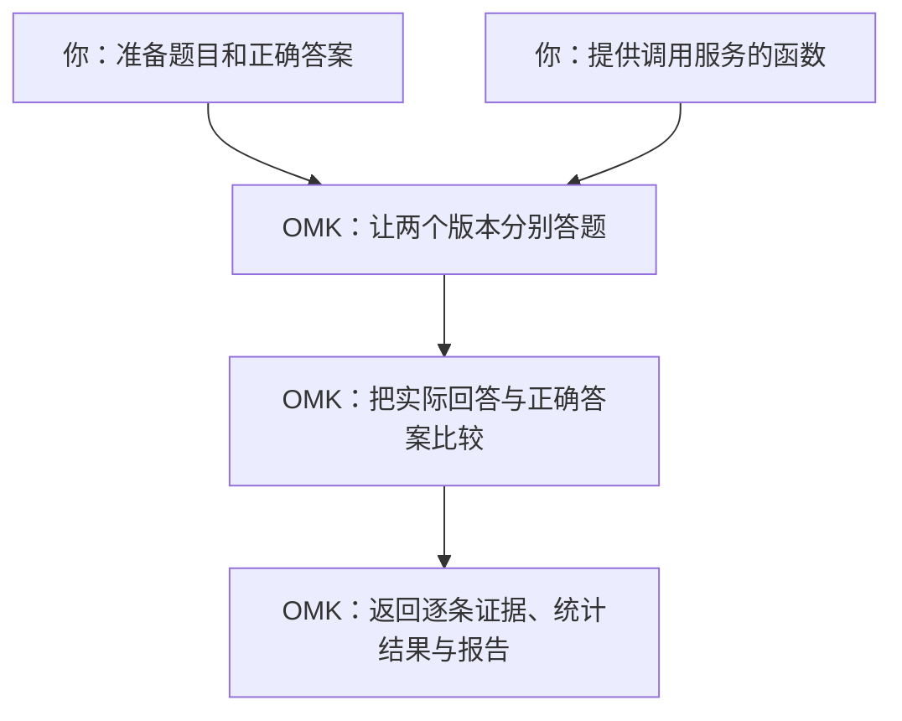

# 在代码里比较两个版本

**eval-runtime 是 OMK 给 Node.js 程序用的评测接口。** 你调用 `evaluate()`，它按你给的题目运行待测版本、给答案打分，再返回比较结果。调用你自己的问答服务、RAG 或 Agent 的代码由你提供。

下面只做一件事：比较一个问答服务的旧版和新版。先看一轮评测到底发生了什么，再运行同一个例子。

## 一轮评测是怎么回事

假设你希望服务只返回城市名。准备三道题，并事先写好正确答案：

| 题目 | 正确答案 | 旧版回答 | 新版回答 |
|---|---|---|---|
| 法国的首都是哪里？ | 巴黎 | 巴黎 ✓ | 巴黎 ✓ |
| 英国的首都是哪里？ | 伦敦 | 伦敦 ✓ | 伦敦 ✓ |
| 日本的首都是哪里？ | 东京 | 京都 ✗ | 东京 ✓ |

你准备前两列，服务运行后产生后两列。**正确答案只交给评分器，不发给待测服务。**

本例用最直接的评分规则：回答与正确答案完全相同就算答对。OMK 因此得到旧版答对 **2/3**、新版答对 **3/3**，新版高约 **33.3 个百分点**。最后还会检查差异是否有足够证据支持；只有三道题，仍不能确认新版稳定地更好。



两个名字到这里就能解释清楚：

| 代码中的名字 | 在这个例子里做什么 |
|---|---|
| `executor`（执行器） | 调用问答服务，拿到「巴黎」这样的实际回答。 |
| `evaluator`（评分器） | 检查实际回答是不是正确答案。 |

## 把这个例子跑起来

<a id="从哪里开始"></a>

需要 Node.js 22 或更高版本。在 OMK 源码仓库根目录运行：

```bash
yarn install --immutable
yarn build
node examples/eval-runtime/run.mjs
```

**这个例子用固定回答模拟上表中的两个版本，不调用模型，也不需要模型账号。** 它帮助你理解评测过程；真实服务的表现需要接入后重新测量。

命令输出一行 JSON。先看这三个字段：

| 字段和值 | 读成人话 |
|---|---|
| `runStatus: "completed"` | 这一轮执行完成了。 |
| `estimate: 0.3333333333333333` | 新版正确率减去旧版正确率，约为 33.3 个百分点。 |
| `verdict: "NOISE"` | 这次差异还不足以确认进步，也不等于两个版本效果相同。 |

`runStatus` 是示例为输出起的名字，对应返回对象里的 `result.status`。结果还带有报告 ID；报告数据由调用方保存，Runtime 不会自动打开 Studio。

<details>
<summary>展开完整可运行代码</summary>

这就是刚才运行的 [run.mjs](https://github.com/lizhiyao/oh-my-knowledge/blob/main/examples/eval-runtime/run.mjs)，无需拼接下面的讲解片段。

<<< @/../examples/eval-runtime/run.mjs{js}

</details>

## 代码里哪些地方对应这轮评测

打开 `examples/eval-runtime/run.mjs`，先找下面三个位置。这里的片段只用于对照完整文件。

**① 题目与正确答案：`dataset.samples`。** 一条记录就是一道题。

```js
{
  sampleId: 'three',
  input: { prompt: '日本的首都是哪里？' },
  expected: '东京',
}
```

**② 待测版本：`variants`。** 本例有 `baseline`（旧版）和 `candidate`（新版）。它们都用同一个 `executor`，用 `config.deployment` 选择版本。演示中的函数只是查固定回答表：

```js
output: answers[config.deployment][input.prompt]
```

OMK 会把每道题分别交给这两个版本，所以三道题一共调用这个函数六次。

**③ 评分与汇总：传给 `evaluate()` 的配置。** 这些配置各管一件事：

| 配置 | 本例表达的意思 |
|---|---|
| `evaluators` | 用 `exact-match` 检查答案是否完全相同。 |
| `comparisons` | 把 `baseline` 当对照，比较 `candidate` 的正确率。 |
| `analyses` | 计算正确率之差及其置信区间。 |
| `decision` | 根据这项分析给出 `NOISE` 等结论；可以不配置。 |

先做一个小实验：把 `answers.candidate` 中日本的答案从 `东京` 改成 `京都`，再次运行。两个版本现在都只答对两道题，`estimate` 应变成 **0**。这能帮你确认：分数来自实际返回的答案。

## 换成自己的服务时，改什么

继续使用这个文件，先替换题目和标准答案，再把 `executor.execute()` 中查表的那一行换成真正的服务调用。调用完成后返回 `{ output, usage }`：`output` 是实际回答，`usage` 是真实用量；不要沿用演示的模拟 token 数字。

若你要比较两个 **prompt**，还要让调用代码把 `artifact.content` 当作实际 prompt 使用。固定模型、工具和其他条件，只改变两个版本的 prompt。本例的查表函数没有使用 prompt 内容，所以改它的 `artifact.content` 不会改变分数。

接入时还有三件事需要与真实服务一致：

- **数据格式：** 用执行器的 `schemas` 声明输入、配置和输出的格式；修改数据后一起修改声明。
- **运行能力：** 随机模型不能照抄示例的 `deterministic`。没有模型种子控制时，声明 `stochastic`、`seedControl: 'unsupported'`，并将 `experiment.sampling` 改为 `{ samplingKind: 'paired', seedCoupling: 'uncontrolled' }`。声明支持取消，就要把 `signal` 传给真实调用。
- **凭证与失败：** 客户端和密钥放在调用函数的闭包里，不放进会被记录的 `config` 或 `runtimeContext`。调用失败应抛错或返回稳定的 `errorCode`，不要编造一个答案继续打分。

完整的模型接入写法在本页下方的[「完全匹配与模型接入代码」](../../reference/integration/eval-runtime-recipes.md#exact-match-评测)中。它使用你自己的模型客户端；部署前按服务容量设置[并发、超时和预算](../../reference/integration/eval-runtime-recipes.md#生产策略)。在独立项目安装 `npm install oh-my-knowledge@next zod`，并使用与已安装版本匹配的示例；尚未发布的能力先用源码运行。

<a id="read-results"></a>
<a id="如何解读结果"></a>

接入真实服务后，先检查 `result.status` 和有效样本覆盖，再看差值与区间。调用失败、缺少证据不能当成零分。用有代表性的题目与独立验证集测量，才能进一步判断改动有没有帮助。


## 按需继续

- [配置与可运行片段](../../reference/integration/eval-runtime-recipes.md)：评分方式、模型接入、持久化、生产策略及 Agent 资源；按需求查阅，不必通读。
- [Runtime API](../../reference/integration/eval-runtime-api.md)：字段与下发契约。
- [平台集成](platform-host-integration.md)：已有调度和存储系统的宿主接线。
