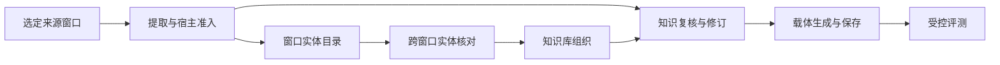

# 知识建设与维护契约

本文是从选定记录到可维护知识及可测量载体改动的端到端设计，负责各阶段的连接、身份边界与架构决策。概念定义只在[知识原理](../../explanation/knowledge.md)维护；用户步骤见[知识维护指南](../../guides/knowledge/extract-knowledge.md)。详细契约由下文链接的阶段规范维护，不在本页复制。

## 1. 已交付范围 {#current-scope}

在用户明确选择的本地知识工作区中，CLI 与 Studio 共用来源归档、候选提炼、核对决定、不可变修订、实体纠正、标签、跨窗口实体核对、实体知识库组织和载体保存流程。人工确认的跨窗口组织已经实现。自动跨 Agent 统一身份不在本设计范围；模型建议与知识库关联均不裁决知识真假，也不证明复用收益。

本设计不要求图数据库、embedding 召回、后台身份合并或自动删除矛盾主张。采纳这些能力前，须分别明确契约并取得对应证据。

## 2. 对象与职责 {#current-objects}

| 对象／记录 | 所有者与职责 |
|---|---|
| 来源窗口 | 保存选定片段、来源身份、范围及限制；后续判断可回到同一证据 |
| 来源实体分析 | 保存窗口内对象、提及及不可变分析修订；不提供跨窗口统一身份 |
| 实体关联核对 | 固定两个窗口的实体、精确模型请求／结果、结构接纳、独立人工决定及可恢复的知识库意图 |
| 知识内容 | 稳定知识身份、不可变内容修订及支持／反对／背景证据；候选是复核状态 |
| 维护决定 | 针对精确知识修订记录保留／舍弃及理由；保留不等于已证实 |
| 知识库对象 | 用户确认的跨窗口组织入口；引用来源身份，不复制知识正文 |
| 标签 | 用户维护的主题组织信息；独立历史，不改变知识内容修订 |
| 知识载体 | 将所选知识修订组织为 skill／prompt 等版本；与知识内容分别保存 |
| 测量证据 | 既有 Core run／report／Decision，验证具体载体改动；不替代知识复核 |

一份载体可以引用多条知识，同一条知识可以出现在多个载体或多个对象入口。它们各自保留身份，不从名称、时间顺序或界面位置推导同一对象或主张真伪。

### 2.1 阶段与契约所有者 {#construction-pipeline}

图中的分支有意保留：实体与知识候选可以共同接纳，知识维护不以知识库关联为前提。知识库增加跨窗口阅读和选择入口，不是第二次提取，也不是第二份内容存储。

| 阶段 | 职责与交接 | 权威规范 |
|---|---|---|
| 窗口提取 | 固定选定来源与限制；派发前准备调用；解码前保存完整执行器返回结果。 | [实体提取](../entities/entity-extraction.md) |
| 宿主准入 | 将精确 quote occurrence 定位为 UTF-16 位置；校验 wire／领域结构及引用闭合；记录理由并拒绝无效提及及其依赖实体／陈述，保留合法 sibling 与原始结果。准入不裁决语义。 | [提取契约](../entities/entity-extraction.md)与[身份规则](../entities/entity-identity.md) |
| 实体目录 | 查询当前窗口分析，保留分析／实体／修订身份，披露不可读分析和来源。检索不生成共享身份。 | [提取存储与目录](../entities/entity-extraction.md) |
| 跨窗口核对 | 规范化召回 → 有界预览 → 明确确认后持久准备 → 受治理模型建议 → 结果归档与接纳 → 人工明确接受／拒绝 → 可恢复应用。召回与模型建议均不能发布组织。 | [实体关联日志](../entities/entity-links.md)；[Studio 传输界面](../studio/studio-entity-links.md) |
| 知识库组织 | 用独立维护的对象引用原窗口身份；确认身份和来源证据；在工作区锁内发布不可变成员修订。 | [实体知识库](knowledge-library.md) |
| 知识维护 | 保留／舍弃精确知识修订、修订正文和来源解释，并显式应用实体纠正。组织关联不自动转移主张。 | [第 3～4 节](#current-revisions)及[维护契约](knowledge-maintenance.md) |
| 载体生成与保存 | 选择精确已保留修订，保留条件与证据，预览改动并保存 skill／prompt 新版本，不改写旧内容。 | [维护与载体契约](knowledge-maintenance.md) |
| 受控评测 | 将载体版本、固定任务模型、用例及评分计划绑定到既有 Core 证据；采纳改动前核对结果，保存与完成评测分别记录。 | [载体评测](knowledge-maintenance.md)及 [Evaluation Core](../evaluation/eval-core-vnext.md) |

### 2.2 身份交接 {#construction-identities}

模型引用只在一个来源窗口内有效。宿主分配的 `analysisId`、`entityId`、`entityRevisionId` 标识接纳及纠正记录，目录召回不替换这些身份。核对固定两个窗口、来源版本、实体修订、所选提及及对象归属写头，只有明确的人工身份决定能够授权知识库应用。

知识库独立的 `objectId` 跨窗口组织这些原始引用，不替代实体 UUID。一个当前窗口实体最多归属一个对象。知识身份及其精确内容修订独立于上述两层，载体引用精确知识修订。新的实体修订、知识库修订、保留决定或载体版本，均不静默升级其它层。

## 3. 知识与修订 {#current-revisions}

知识正文保留陈述、条件、时间、例外、未知与来源解释。陈述的主体／对象角色与来源实体身份分开；识别出实体不要求生成知识。来源断言、实际执行和提炼推断不混写。

修改内容生成新修订，旧正文与旧处理理由完整保留。旧决定不自动继承到新版本。实体纠正也不回写知识；用户核对并明确应用精确实体修订后，才生成知识新修订。

来源匹配只证明定位与引用闭合，不证明陈述得到支持。无法读回来源时保留已保存记录并显示限制，不伪造原文或无问题结论。

## 4. 组织与载体维护 {#current-maintenance}

### 4.1 知识库组织 {#current-library}

窗口实体与知识库对象通过用户确认的关联连接。关联固定分析、实体、实体修订和原文提及，名称相同不自动归并。组件、实例、版本及未知身份的约束由[实体身份规范](../entities/entity-identity.md)规定。

[实体关联日志](../entities/entity-links.md)将 `same_object`、`different_objects` 或 `insufficient_evidence` 记录为模型建议。接纳的建议仍需独立的人工决定与理由。接受可以覆盖模型建议，但保留原建议，不把该决定换算为模型质量分数。拒绝不改变来源实体、知识或知识库，并抑制该精确已核对对。

组织历史与内容历史分别保留。知识绑定与组织关联的实体修订不一致时，列为关联待核对；不能进入当前对象已保留知识或默认载体选择。解除关联不删除知识，空对象保留历史。完整规则见[知识库规范](knowledge-library.md)。

### 4.2 载体维护与效果 {#current-carriers}

知识改动经历提议、复核、形成候选、关联评测和采纳或拒绝。是否已评测、是否已写入、是否已发布分别记录，不能强制所有场景服从一条线性顺序。

生成只纳入用户选择的精确已保留修订，保留条件与证据分类。更新载体时按本次选择重建知识区，保留知识区外的手工内容及依赖资产；旧载体版本不改写。知识变化只产生提醒和待核对状态，不后台改写载体。

保存、实际使用和受控效果验证分别记账。版本、预览冲突、维护提醒和逐项更新核对由[知识维护契约](knowledge-maintenance.md)及知识维护流程约束。

## 5. 数据与应用边界 {#current-implementation}

`knowledge/` 拥有纯内容契约、校验和历史规则；外层观测应用及文件系统 adapter 负责归档、模型调用和持久化，CLI／Studio 共享这些应用流程。知识库组织不成为第二份知识内容存储。

写入携带预期版本，冲突时重新读取并核对；只通过允许的工作区位置保存。当前格式和恢复行为以[实体提取](../entities/entity-extraction.md)及[存储布局](../shared/storage-layout-spec.md)为准。本页不另列一份会漂移的 Schema。

### 5.1 失败与恢复交接 {#construction-recovery}

| 边界 | 必须保留的结果与下一步 | 契约所有者 |
|---|---|---|
| 模型结果被拒绝、格式错误、不支持或部分无效 | 先保留完整返回结果，再记录解码／接纳事实。提取的合法 sibling 可保留，无效依赖不能通过；关联接纳失败时禁止接受与知识库发布，仍可通过明确人工拒绝结束核对。 | 提取与实体关联规范 |
| 调用启动后进程丢失，未留下结果 | 保留 running／unknown 证据与已消费调用身份；读取、重载、恢复均不重发。明确重新确认的重试使用新身份并另占额度。 | 提取与实体关联规范 |
| 预览后来源／实体／对象归属变化 | 在同一工作区锁内重验固定写头及精确来源位置；拒绝过期准备，或在决定后记录明确应用冲突。修复来源／组织后，以当前绑定创建新核对。 | 实体关联日志与知识库规范 |
| 知识库已提交，确认或日志追加失败 | 用同一命令／收据恢复持久稳定意图，记录已提交事实，不新增模型调用或重复库修订。未知 I/O 保持可重试，不伪称已经证实拒绝。 | 实体关联日志 |
| 知识或实体修订变化 | 保留旧内容、决定及绑定；将不匹配项列为待核对，明确应用所选修订。解除知识库关联不删除知识。 | 知识库与维护规范 |
| 载体保存或评测中断 | 保留旧版本；下一次操作前核对不确定保存／运行。恢复写入或查看既有运行，不后台改写或自动重发模型。 | 维护契约 |

这些是可恢复的应用边界，不是多文件文件系统事务，也不保证远端恰好一次交付。缺失、损坏和不可读证据，必须与健康空结果区分。

## 6. 验收与限制 {#current-evidence}

功能闭环的验收覆盖持续积累、旧知识修订、来源与版本回看、组织关联，以及载体提醒／更新一致性。功能可用不等于整体提炼准确率、知识真实性或任务收益已验收；这些证据各自记录。

结构接纳、真实进程／服务动线验收、人工组织决定、独立复核的语义质量分别记证据。提取质量版本、被测范围及就绪状态只由[提取评测协议](../entities/entity-extraction-evaluation.md)维护；来源回放与 demonstrations 不继承这些结论。[实体关联评测协议](../entities/entity-link-evaluation.md)另行绑定冻结的三判别标准、输入、受治理请求、checker 及复核记录。工作区的接纳／决定观测各自保留分母，不将人工组织决定换成语义标签。一次模型调用成功或人工接受组织，均不自动满足独立质量复核。

## 7. 调研与决策 {#construction-decisions}

下列原始来源用于架构取舍，其性能结果不构成 OMK 的效果证据。“采纳”与“改编”针对表中设计实践，不表示引入这些框架依赖。

| 原始来源 | 相关实践 | OMK 决策与理由 |
|---|---|---|
| [GraphRAG Dataflow](https://microsoft.github.io/graphrag/index/default_dataflow/) | TextUnit 保留来源追溯；默认图提取将标题和类型相同的实体合并。 | **采纳**来源到派生记录的追溯；**拒绝**标题／类型合并与全图索引：同名对象可能属于不同项目、实例或版本，原始身份须可核对。 |
| [Mem0 论文 §2.1](https://arxiv.org/html/2504.19413v1#S2.SS1)及[当前 add 契约](https://docs.mem0.ai/core-concepts/memory-operations/add) | 论文将提取与针对既有记忆的 ADD／UPDATE／DELETE／NOOP 增量裁决分开；当前 add 文档改为描述追加存储，两者属于不同来源范围。 | **改编**与既有记录增量对账的思路。模型建议与人工明确决定、不可变修订分离；不由 LLM 覆写／删除主张，不从召回相似度推断身份。论文的四操作不被写成现行 API 默认行为。 |
| [Neo4j Agent Memory：消解与去重](https://neo4j.com/labs/agent-memory/explanation/resolution-deduplication/) | 消解判断两个引用是否指同一事物，去重执行该判断；相似度信号及类型约束不能单独证明身份。 | **采纳**分层，**改编**为 recall／preview／proposal 与人工 decide／知识库发布分离。拒绝相似度阈值自动合并，误转移身份的代价要求可见的来源核对。 |
| [Graphiti 时态上下文图](https://github.com/getzep/graphiti#why-graphiti)及[事实时间字段](https://github.com/getzep/graphiti/blob/main/graphiti_core/edges.py) | 事实保留来源 episode 及时间历史，包括 `valid_at`／`invalid_at`；信息变化可自动使旧事实失效并保留历史。 | **采纳**来源追溯与历史保留；**拒绝**自动按时间裁决真值／身份失效：晚到陈述可能是计划、纠正、不同条件或冲突。采用不可变修订与明确纠正、舍弃或解除关联；时间和来源断言是证据，不是自动裁决。 |
| [LangExtract 来源定位](https://github.com/google/langextract) | 提取映射回来源片段，无法定位的输出显式无 grounding。 | **采纳并收紧**宿主定位：要求精确连续 quote，重复文本明确选择 occurrence，再拒绝无 grounding 或歧义定位的依赖。精确位置仍不证明语义身份或主张支持。 |
