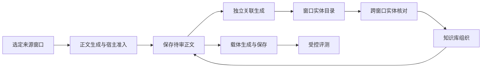

# 知识建设与维护契约

本文是从选定记录到可维护知识及可测量载体改动的端到端设计，负责各阶段的连接、身份边界与架构决策。概念定义只在[知识原理](../../explanation/knowledge.md)维护；用户步骤见[知识维护指南](../../guides/knowledge/extract-knowledge.md)。详细契约由下文链接的阶段规范维护，不在本页复制。

## 1. 已交付范围 {#current-scope}

在用户明确选择的本地知识工作区中，CLI 与 Studio 共用来源归档、候选提炼、核对决定、不可变修订、实体纠正、标签、跨窗口实体核对、实体知识库组织和载体保存流程。人工确认的跨窗口组织已经实现。自动跨 Agent 统一身份不在本设计范围；模型建议与知识库关联均不裁决知识真假，也不证明复用收益。

本设计不要求图数据库、embedding 召回、后台身份合并或自动删除矛盾主张。采纳这些能力前，须分别明确契约并取得对应证据。

## 2. 对象与职责 {#current-objects}

| 对象／记录 | 所有者与职责 |
|---|---|
| 来源窗口 | 保存选定片段、来源身份、范围及限制；后续判断可回到同一证据 |
| 来源实体分析 | 保存窗口内对象、提及及不可变分析修订；不提供跨窗口统一身份 |
| 实体关联核对 | 固定两个窗口的实体、精确模型请求／结果、结构接纳、独立人工决定及可恢复的知识库意图 |
| 知识正文 | 稳定知识／修订／段落身份、完整自然语言段及 inline 精确来源证据；新修订待审 |
| 派生关联 | 精确 body digest 的独立实体／可选 typed 投影；单独修订和接受／拒绝审查，不成为第二份正文 |
| 维护决定 | 针对精确知识修订记录保留／舍弃及理由；保留不等于已证实 |
| 知识库对象 | 用户确认的跨窗口组织入口；引用来源身份，不复制知识正文 |
| 标签 | 用户维护的主题组织信息；独立历史，不改变知识内容修订 |
| 知识载体 | 将所选知识修订组织为 skill／prompt 等版本；与知识内容分别保存 |
| 测量证据 | 既有 Core run／report／Decision，验证具体载体改动；不替代知识复核 |

一份载体可以引用多条知识，同一条知识可以出现在多个载体或多个对象入口。它们各自保留身份，不从名称、时间顺序或界面位置推导同一对象或主张真伪。

### 2.1 阶段与契约所有者 {#construction-pipeline}

顺序有意明确：完整正文先接纳并保存，再独立调用模型生成关联。缺失或失败的投影不阻断正文读取与维护。知识库增加跨窗口组织，不成为第二份主数据。

| 阶段 | 职责与交接 | 权威规范 |
|---|---|---|
| 窗口提取 | 固定来源及每阶段请求；解码前保存各完整返回原件，先保存接纳正文，再生成关联。 | [实体提取](../entities/entity-extraction.md) |
| 宿主准入 | 将精确 quote occurrence 定位为 UTF-16 位置，校验 wire／领域结构及引用闭合；保留合法正文 sibling 与原始结果，派生校验不删除已保存正文。准入不裁决语义。 | [提取契约](../entities/entity-extraction.md)与[身份规则](../entities/entity-identity.md) |
| 实体目录 | 查询当前窗口分析，保留分析／实体／修订身份，披露不可读分析和来源。检索不生成共享身份。 | [提取存储与目录](../entities/entity-extraction.md) |
| 跨窗口核对 | 规范化召回 → 有界预览 → 明确确认后持久准备 → 受治理模型建议 → 结果归档与接纳 → 人工明确接受／拒绝 → 可恢复应用。召回与模型建议均不能发布组织。 | [实体关联日志](../entities/entity-links.md)；[Studio 传输界面](../studio/studio-entity-links.md) |
| 知识库组织 | 用独立维护的对象引用原窗口身份；确认身份和来源证据；在工作区锁内发布不可变成员修订。 | [实体知识库](knowledge-library.md) |
| 知识维护 | 保留／舍弃精确知识修订、修订完整正文与 inline 精确证据，独立应用／审查实体关联。组织关联不自动转移主张。 | [第 3～4 节](#current-revisions)及[维护契约](knowledge-maintenance.md) |
| 载体生成与保存 | 选择精确已保留修订，保留条件与证据，预览改动并保存 skill／prompt 新版本，不改写旧内容。 | [维护与载体契约](knowledge-maintenance.md) |
| 受控评测 | 将载体版本、固定任务模型、用例及评分计划绑定到既有 Core 证据；采纳改动前核对结果，保存与完成评测分别记录。 | [载体评测](knowledge-maintenance.md)及 [Evaluation Core](../evaluation/eval-core-vnext.md) |

### 2.2 身份交接 {#construction-identities}

模型引用只在一个来源窗口内有效。宿主分配的 `analysisId`、`entityId`、`entityRevisionId` 标识接纳及纠正记录，目录召回不替换这些身份。核对固定两个窗口、来源版本、实体修订、所选提及及对象归属写头，只有明确的人工身份决定能够授权知识库应用。

知识库独立的 `objectId` 跨窗口组织这些原始引用，不替代实体 UUID。一个当前窗口实体最多归属一个对象。知识身份及其精确内容修订独立于上述两层，载体引用精确知识修订。新的实体修订、知识库修订、保留决定或载体版本，均不静默升级其它层。

## 3. 知识与修订 {#current-revisions}

Canonical 草稿为 `{title, content: {segments: [{segmentId, text, evidence}], organization?}, reuseRationale}`。每个 segment 是可独立消费的完整正文单元；text 自含必要条件、归因、否定、时间、例外与未知，不能靠引文、标题或目录补义。每条 evidence 含 `source: {snapshotId, sourceVersion}`、`selection: {evidenceRef, start, end, quote}`、`basis` 及可选 `interpretation`。生成与修订时，宿主从来源核对连续逐字 UTF-16 位置。

知识历史使用 Schema 3，不可变修订新增 `bodyDigest`，按版本化 canonical title／content／reuseRationale 计算。独立关联历史绑定精确 `{knowledgeId, revisionId, bodyDigest}`、可选目录修订、`segmentEntityRefs`、可选 `typedRelations` 与未决 issues。typedRelations 省略表示未请求，空数组表示请求后未形成关系；`available` 只表示结构可读，不表示身份或真值已确认。接受／拒绝审查只作用于该投影，每个新投影重新待审。

修改正文创建新正文修订，不继承旧保留／舍弃决定。实体纠正、手工应用关联和模型辅助重建创建或选择独立派生修订，不改写正文。指向其它 body digest 的投影为 stale。来源删除后正文仍可读，证据明确显示不可用，不伪造原文或健康空结果。

## 4. 组织与载体维护 {#current-maintenance}

### 4.1 知识库组织 {#current-library}

窗口实体与知识库对象通过用户确认的关联连接。关联固定分析、实体、实体修订和原文提及，名称相同不自动归并。组件、实例、版本及未知身份的约束由[实体身份规范](../entities/entity-identity.md)规定。

[实体关联日志](../entities/entity-links.md)将 `same_object`、`different_objects` 或 `insufficient_evidence` 记录为模型建议。接纳的建议仍需独立的人工决定与理由。接受可以覆盖模型建议，但保留原建议，不把该决定换算为模型质量分数。拒绝不改变来源实体、知识或知识库，并抑制该精确已核对对。

组织历史与内容历史分别保留。知识绑定与组织关联的实体修订不一致时，列为关联待核对；不能进入当前对象已保留知识或默认载体选择。解除关联不删除知识，空对象保留历史。完整规则见[知识库规范](knowledge-library.md)。

### 4.2 载体维护与效果 {#current-carriers}

知识改动经历提议、复核、形成候选、关联评测和采纳或拒绝。是否已评测、是否已写入、是否已发布分别记录，不能强制所有场景服从一条线性顺序。

生成只纳入用户选择的精确已保留修订，保留条件与证据分类。更新载体时按本次选择重建知识区，保留知识区外的手工内容及依赖资产；旧载体版本不改写。知识变化只产生提醒和待核对状态，不后台改写载体。

保存、实际使用和受控效果验证分别记账。版本、预览冲突、维护提醒和逐项更新核对由[知识维护契约](knowledge-maintenance.md)及知识维护流程约束。

## 5. 数据与应用边界 {#current-implementation}

`knowledge/` 拥有纯内容契约、校验和历史规则；其 `application/` 拥有 CLI／Studio 共用用例与本地装配，`adapters/` 负责来源读取、模型传输和文件持久化。观测层提供轨迹解析，交付层负责宿主配置与展示。知识库组织不成为第二份知识内容存储。

写入携带预期版本，冲突时重新读取并核对；只通过允许的工作区位置保存。生成使用 current-only 的 `knowledge-generation-journal` Schema 2，不把两个原生原件装成 run5。当前格式和恢复行为以[实体提取](../entities/entity-extraction.md)及[存储布局](../shared/storage-layout-spec.md)为准。本页不另列一份会漂移的 Schema。

### 5.1 失败与恢复交接 {#construction-recovery}

| 边界 | 必须保留的结果与下一步 | 契约所有者 |
|---|---|---|
| 模型结果被拒绝、格式错误、不支持或部分无效 | 先保留完整返回结果，再记录解码／接纳事实。提取的合法 sibling 可保留，无效依赖不能通过；关联接纳失败时禁止接受与知识库发布，仍可通过明确人工拒绝结束核对。 | 提取与实体关联规范 |
| 调用启动后进程丢失，未留下结果 | 保留 running／unknown 证据与已消费调用身份。实体关联另可明确人工终止，不宣称 owner 已退出；仍保留尚未归档的 producer 容量，迟到输出只归档、不接纳。读取、重载、恢复均不重发；重新确认的重试使用新身份并另占额度，明确绑定终止前驱。 | 提取规范与[实体关联恢复](../entities/entity-links.md#human-termination) |
| 预览后来源／实体／对象归属变化 | 在同一工作区锁内重验固定写头及精确来源位置；拒绝过期准备，或在决定后记录明确应用冲突。修复来源／组织后，以当前绑定创建新核对。 | 实体关联日志与知识库规范 |
| 知识库已提交，确认或日志追加失败 | 用同一命令／收据恢复持久稳定意图，记录已提交事实，不新增模型调用或重复库修订。未知 I/O 保持可重试，不伪称已经证实拒绝。 | 实体关联日志 |
| 知识或实体修订变化 | 保留旧内容、决定及绑定；将不匹配项列为待核对，明确应用所选修订。解除知识库关联不删除知识。 | 知识库与维护规范 |
| 载体保存或评测中断 | 保留旧版本；下一次操作前核对不确定保存／运行。恢复写入或查看既有运行，不后台改写或自动重发模型。 | 维护契约 |

这些是可恢复的应用边界，不是多文件文件系统事务，也不保证远端恰好一次交付。缺失、损坏和不可读证据，必须与健康空结果区分。

### 5.2 显式迁移旧数据 {#body-migration}

这是 **BREAKING-SCHEMA/API/COMPARABILITY**。当前 reader 只接受正文历史 Schema 3 和新日志，不静默读取旧 typed 知识 v2 或恢复 run5；旧运行清单明确 unsupported。历史 typed study 的只读核对／可携带归档重放保留冻结测量身份，当前构建不支持旧 typed 生成计划，并且零调用。

显式运行 `omk observe knowledge migrate --from-workspace ./old-knowledge --workspace ./new-knowledge`，两个路径均须提供。源码构建 adapter 依次调用 `adapters/knowledge-migration` 的 `inspectLegacyKnowledgeWorkspace`、`prepareKnowledgeMigration`、`applyKnowledgeMigration(plan, expectedPlanDigest)`；命令不调用模型，也不覆盖旧工作区。Prepare 只接受独立的新空工作区，固定 ID、来源 pin 与计划摘要但不写目标。Apply 将所有原始字节以 base64 保存在 `migration/<migrationId>/original/`，发布精确计划／映射，并复制支持的 source／entity 记录。每个旧修订机械渲染为**新的待审**正文修订；原 typed 字段、原生记录、决定与谱系留档。旧 retain 不继承，library／carrier／跨窗精确引用不自动改指向。

Apply 核对原清单和计划正文写入；同计划恢复幂等，目标被编辑时拒绝。机械字段保留与映射不等于来源保真或任务验收。保留或使用前仍需核对新段落及证据。旧工作区不变，可继续用匹配旧 binary 读取；回退是重新打开保全的旧目录与旧程序，不引入永久双 canonical reader。

### 5.3 知识图谱读取投影 {#knowledge-graph}

应用层的 `graph({knowledgeIds?, includeHistory?})` 返回只读 `knowledge-graph` 投影（Schema 1），不创建新的持久化主数据或调用模型。显式选择最多 1,000 条知识；空选择是空范围。知识节点固定 `{knowledgeId, revisionId, bodyDigest}`，实体节点固定 `{analysisId, entityRevisionId, entityId}`，来源节点固定 `{snapshotId, sourceVersion}`。同名节点不合并。

正文依据边保留段落、原 evidence 和位置核对状态；段落实体边保留精确投影、目录修订及 mention ID。typed 关系、组件、集合、可能身份和修订父子边只投影已有记录，不从共现推断。默认展示当前正文及其实际绑定；历史需明确展开，旧投影不能标为当前。当前投影绑定旧目录时，保留原绑定，并用 `catalogCurrent` 与实体修订状态单独提示，不自动换头。

覆盖状态与已知节点／边分别返回。当前正文缺少可用关联、绑定目录过期、来源异常或位置不匹配等形成明确缺口；历史关联结果保留各自状态。来源异常局部降级，正文和其它可读依据保留，不暴露原始异常或来源元数据中的文件路径。请求范围内的大库、长历史总图规模仍取决于已有记录，不将小范围操作证据泛化为负载保证。

`associationCatalogs(id, revisionId?)` 只列出与该正文 evidence 的精确来源身份匹配的目录及可选修订，返回来源摘要与不可读分析数量。目录召回不确认身份；写入使用多目录 `applyAssociations`、乐观并发和新投影待审规则。草稿显式携带完整 `catalogRefs`；段落实体和 typed 端点均由目录、目录修订及实体共同限定。Studio 仅传输、呈现该领域投影并组织用户动作，不读取底层文件或重新定义关系。

## 6. 验收与限制 {#current-evidence}

功能闭环的验收覆盖持续积累、旧知识修订、来源与版本回看、组织关联，以及载体提醒／更新一致性。功能可用不等于整体提炼准确率、知识真实性或任务收益已验收；这些证据各自记录。

结构接纳、真实进程／服务动线验收、人工组织决定、独立复核的语义质量分别记证据。提取质量版本、被测范围及就绪状态只由[提取评测协议](../entities/entity-extraction-evaluation.md)维护；来源回放与 demonstrations 不继承这些结论。[实体关联评测协议](../entities/entity-link-evaluation.md)另行绑定冻结的三判别标准、输入、受治理请求、checker 及复核记录。工作区的接纳／决定观测各自保留分母，不将人工组织决定换成语义标签。一次模型调用成功或人工接受组织，均不自动满足独立质量复核。

## 7. 调研与决策 {#construction-decisions}

下列原始来源用于架构取舍，其性能结果不构成 OMK 的效果证据。“采纳”与“改编”针对表中设计实践，不表示引入这些框架依赖。

下列 Mem0、OWASP 与 ACE 映射核对于 2026-10-21。论文和 OWASP 发布明确版本或日期；持续更新的 Mem0 文档只说明所引操作，不代表所有版本。这些对照不构成行业共识、OWASP 合规或 OMK 质量验收结论。

| 原始来源 | 相关实践 | OMK 决策与理由 |
|---|---|---|
| [GraphRAG Dataflow](https://microsoft.github.io/graphrag/index/default_dataflow/) | TextUnit 保留来源追溯；默认图提取将标题和类型相同的实体合并。 | **采纳**来源到派生记录的追溯；**拒绝**标题／类型合并与全图索引：同名对象可能属于不同项目、实例或版本，原始身份须可核对。 |
| [Mem0 论文 v1 §2.1（2025-04）](https://arxiv.org/html/2504.19413v1#S2.SS1) | 提取之后，针对既有记忆作 ADD／UPDATE／DELETE／NOOP 对账。 | **改编**与既有记录对账的思路，将模型建议、维护决定和不可变内容修订分离；召回相似度不能确立身份。论文操作不定义现行 API。 |
| [Mem0 OSS v2→v3 迁移](https://docs.mem0.ai/migration/oss-v2-to-v3)、[update](https://docs.mem0.ai/core-concepts/memory-operations/update) 及 [history](https://docs.mem0.ai/api-reference/memory/history-memory) | 迁移指南规定 ADD-only 提取；显式 update 仍替换已存内容，history 提供变更日志。追加提取与历史记录不等于统一的不可变修订契约。 | **采纳**新增提取与既有内容维护的区分。OMK 保留不可变内容修订和精确版本的决定，不采用原地替换内容，也不声称 Mem0 v3 已具备相同修订语义。 |
| [Neo4j Agent Memory：消解与去重](https://neo4j.com/labs/agent-memory/explanation/resolution-deduplication/) | 消解判断两个引用是否指同一事物，去重执行该判断；相似度信号及类型约束不能单独证明身份。 | **采纳**分层，**改编**为 recall／preview／proposal 与人工 decide／知识库发布分离。拒绝相似度阈值自动合并，误转移身份的代价要求可见的来源核对。 |
| [Graphiti 时态上下文图](https://github.com/getzep/graphiti#why-graphiti)及[事实时间字段](https://github.com/getzep/graphiti/blob/main/graphiti_core/edges.py) | 事实保留来源 episode 及时间历史，包括 `valid_at`／`invalid_at`；信息变化可自动使旧事实失效并保留历史。 | **采纳**来源追溯与历史保留；**拒绝**自动按时间裁决真值／身份失效：晚到陈述可能是计划、纠正、不同条件或冲突。采用不可变修订与明确纠正、舍弃或解除关联；时间和来源断言是证据，不是自动裁决。 |
| [LangExtract 来源定位](https://github.com/google/langextract) | 提取映射回来源片段，无法定位的输出显式无 grounding。 | **采纳并收紧**宿主定位：要求精确连续 quote，重复文本明确选择 occurrence，再拒绝无 grounding 或歧义定位的依赖。精确位置仍不证明语义身份或主张支持。 |
| [OWASP Agentic Top 10 2026，ASI06：Memory & Context Poisoning（2025-12-09）](https://genai.owasp.org/resource/owasp-top-10-for-agentic-applications-for-2026/) | 持久污染会影响后续会话；缓解措施包括来源归属、记忆隔离、写入前校验、版本恢复和高风险动作的人工复核。 | **改编**来源追溯、明确来源范围、保留修订与分开的晋升门槛。候选写入和 Agent 修订不要求独立人工复核；跨窗口知识库发布需要明确人工决定，载体预览选择当前已保留的精确修订，保存前重新核对这些引用并生成新版本。这些边界不证明抗投毒效果，也不表示已实现全部 ASI06 缓解措施。 |
| [ACE v3，§§3.1–3.2（2026-03-29）](https://arxiv.org/html/2510.04618v3) | 结构化条目接收局部增量，生成、反思与整理分离；精炼可更新条目并去除冗余。 | **改编**逐条维护与精确知识修订的明确选择。OMK 当前重建所选载体知识区段并保存新版本，没有实现 ACE 的增量合并／裁剪或自主在线适应；载体收益仍须受控测量。 |

## 8. 后续扩展的架构决定（设计，尚未实施） {#extension-boundaries}

本节记录 [#1392](https://github.com/lizhiyao/oh-my-knowledge/issues/1392) 的扩展边界。**第 8.2 节多目录关联及第 8.4 节相应 Schema 2／副本迁移已实施；来源中立适配器与可信公共操作者上下文仍是设计。** 本轮保持来源窗口、正文、实体历史、载体及操作者数据形状；新关联 profile／wire 与日志独立版本化，不改写历史测量。

### 8.1 来源中立的快照与适配器 {#neutral-source-design}

未来由 knowledge 纯契约层拥有来源引用、不可变快照、选区与解析状态；文件读取、Git 解析、日志投影和授权检查由各自适配器实现，应用层编排捕获与模型调用。公共 DTO 采用 SourceSnapshot 替换 EvidenceWindow，并明确 SourceExcerpt、SourceSelection、SourceResolution 及 EvidenceStore 的新版端口；通用端口不再用 TraceSourceKind、记录序号或 thread／turn 定义所有来源。

| 契约 | 已确定的设计职责 |
|---|---|
| snapshot | 保存 sourceKind、snapshotId、sourceVersion、capturedAt、原始内容引用、投影版本、excerpts 和 limitations。sourceVersion 由捕获字节、来源身份、选区和投影版本按显式摘要版本计算，不包含本次捕获时间；上游修改生成新快照，旧引用不跟随最新文件。 |
| selection | 按 sourceKind 区分日志记录范围、选定文件范围和固定提交／文件；适配器将选择转换为可预览的来源清单。绝对路径与读取句柄留在宿主，模型只收到已授权的来源归因、片段与限制。 |
| excerpt | 每段保留 evidenceRef、精确文本及来源坐标。知识继续用连续 quote 与宿主核对的 UTF-16 start／end 引用该文本；文件行号、Git blob 或日志记录号作为来源坐标，不替代正文引文。 |
| resolution | 返回精确引用的 available 或 unavailable，后者区分缺失、损坏、版本不符、删除及无权限。缺少来源不等于空资料，读取旧快照也不证明它仍代表项目现状。 |

首批 sourceKind 固定为 agent_trace、project_file 和 git_blob，选区分别描述日志记录范围、选定文件范围、固定提交中的文件范围。trace 适配器保留原 TraceSourceKind、原始记录和会话归因；file 记录选定工作区内的相对位置与捕获内容版本；git 解析为固定 commit／tree／blob 和路径，分支名仅是选择输入，工作区未提交内容单独捕获。首批 file／git 只接入选定的 UTF-8 文本，二进制或需转换的资料明确 unsupported，不调用模型；转换器另行版本化。文档的设计陈述、代码实现、测试预期与实际执行结果保留材料类型和依据层级，不把测试源码当成已执行结果。

读取授权、向模型发送和保存知识分别检查；快照存在不能代替本次发送权限。权限撤回或删除标记使新读取／派发明确不可用，已保存正文仍保留历史及来源状态。沿用历史保全与删除标记的范围，彻底擦除须独立定义；不把删除来源说成所有派生内容已清除。新资料版本只产生受影响知识／目录／投影的待复核线索，不自动修改知识正文、接受关系或覆盖维护决定。

### 8.2 多来源正文与多个实体目录 {#multi-catalog-design}

当前正文及关联重建支持多个精确来源，关联历史 Schema 2 采用**来源目录独立、投影显式组合**：一个实体分析继续绑定一个精确来源快照，不建立按名称合并的全局实体目录。

- 关联投影固定 bodyRef 及完整 catalogRefs 集合。实体端点使用 `{analysisId, entityRevisionId, entityId}`，提及在此基础上增加 mentionId；不能只凭 entityId 或显示名称推导目录。每个 segmentEntityRefs 项固定 segmentId、目录限定的实体和 mention 引用；提及必须属于所声明目录，并能回到该段正文绑定的精确来源。
- typed 关系的主体／客体使用相同的目录限定实体引用，证据可以来自正文已引用的多个快照。模型建议、来源歧义、关联审查和人工跨窗口身份决定继续分开；跨目录关系不等于同一对象合并。
- 正文 revisionId 或 digest 变化使旧投影不再适配。目录新增修订时，旧精确关联仍可历史读回，当前目录差异明确待复核；重新应用或重建产生新待审投影，不继承旧接受决定。任何目录／来源不可用均单独报告，不能让它抹去其余正文或伪装为零关联。
- 知识库继续引用原目录身份与人工决定。已固定的历史快照仍可支持历史陈述；上游文件变更、来源删除、解除组织成员和正文被舍弃分别处理，不自动裁决真值，也不连带删除正文。跨目录投影与图谱查询按精确目录工作；新文件／Git 来源和来源变化的待复核传播仍待独立交付验收。

### 8.3 实际操作者与委托用户 {#actor-context-design}

当前 KnowledgeActor 已区分 human 与带 executionRef 的 agent，但本地装配把维护调用者固定为 human/local-user；生成阶段另记 extractor Agent。该默认值不能证明每次 CLI 维护都由真人直接执行，旧记录也不能据此自动重标。

后续决定：知识修订的 createdBy／revisedBy 和维护 actor 记录**实际执行写入的主体**；委托用户与授权范围由可信宿主 principal／授权记录保存，使用精确 requestId 与写入回执关联。Agent 代用户写入时记录 agent 及稳定 executionRef，真人委托不将执行者改记为 human。跨窗口发布需要的人工身份决定仍独立保留。

可信身份由 CLI 启动上下文、已认证的服务会话或受信任 Agent runtime 注入应用端口；浏览器请求、模型生成内容和任意请求 payload 的自报 actor 不作身份依据。无法确定实际操作者的写调用应显式拒绝并要求补足宿主上下文，读取仍可按原权限进行。现有 KnowledgeActor 形状可复用；这不是当前 CLI 已提供的新参数或认证能力，也不扩大操作授权。

### 8.4 版本、迁移与实施交接 {#extension-migration-plan}

多目录关联与副本迁移已获明确批准并实施。下表的来源窗口与公共操作者扩展仍须各自确认；不随 Schema 2 一并更换。

| 受影响面 | 版本与迁移决定 |
|---|---|
| 来源窗口与 capture／source DTO | SourceSnapshot 采用 knowledge-window-v3；SourceExcerpt、SourceSelection、SourceResolution、EvidenceStore 和 capture API 一起替换，selection 不再只有 path／记录范围，resolution 增加权限等状态。旧 v2 原始字节与摘要原样归档，显式适配器在新目录生成 v3 快照及引用映射；不重解释旧 sourceVersion，不增加永久双 reader。 |
| 正文与实体历史 | 现有正文 Schema 3 已能表达多来源证据，实体历史 v2 可保持一个目录一个快照。旧引用若迁移为新快照引用，则创建新待审正文修订及明确目录映射，不沿用旧正文 digest、保留或关联接受状态；旧目录、正文与载体引用不自动重定向。单纯新增派生投影不改变正文或其维护决定。 |
| 关联与生成日志 | 当前多目录关联采用 association history Schema 2，生成日志采用 journal Schema 2、knowledge-body-first/v2；关联阶段使用新 profile／wire identity，正文阶段的 prompt／profile／wire 字节不变。旧 v1 投影可显式转换为单元素 catalogRefs 的新待审投影；旧原件、回执和未知派发身份保留，迁移不重新调用模型或恢复派发旧请求。旧日志保留原字节并显示 unsupported，不伪造新日志身份；旧自动授权／调度只归档，不继承。 |
| 操作者上下文 | 复用 human／agent 数据形状；公共 CLI／服务的可信上下文输入与缺失时拒绝行为需明确发布影响。旧 actor 和回执不回写；如需新增落盘授权记录，先单独版本化其契约与保留范围。 |
| 组织、载体与测量 | 组织成员、精确载体引用及历史测量保持原身份。需要重新关联时显式核对后保存新修订；既有 prompt、wire、评分、历史分母与旧实验不重算，新生成／关联行为以独立测量身份验证。 |

实施交接须提交来源支持清单、DTO／落盘 Schema 差异、引用映射、保存位置、迁移前检查及回退方式，确认后再写入新版本。回退使用保全的旧工作区及匹配旧 binary；新工作区保留迁移原件和映射。多目录图谱与直接项目资料接入分别验收；前者不证明文件／Git 摄取或存量项目建库已完成。
